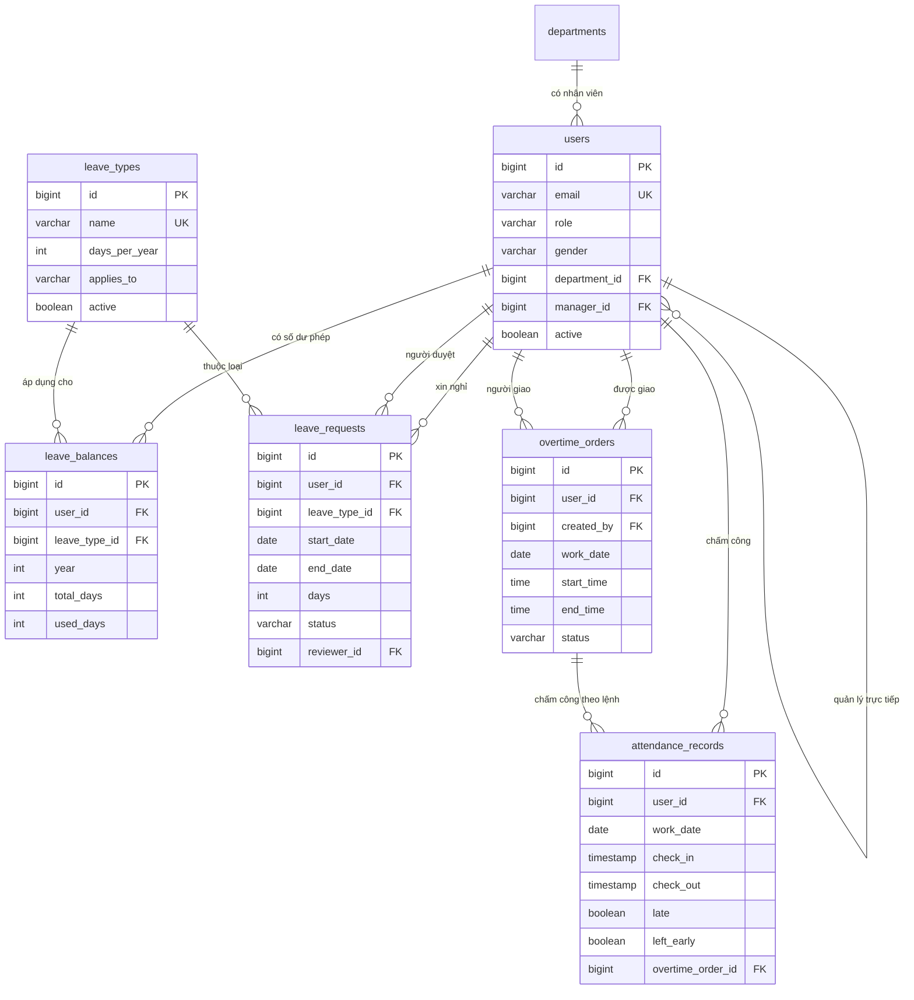

# LAMS - Hệ thống quản lý nghỉ phép và chấm công

Ứng dụng web nội bộ cho doanh nghiệp: nhân viên xin nghỉ phép và chấm công, quản lý duyệt đơn và giao việc làm thêm giờ, quản trị viên quản lý người dùng, phòng ban, loại nghỉ phép. Có báo cáo chấm công theo tháng và xuất ra Excel.

Đây là dự án học tập nhằm thực hành xây dựng một ứng dụng nghiệp vụ hoàn chỉnh với Java và Spring Boot: phân tầng rõ ràng, quản lý phiên bản database, phân quyền nhiều lớp, xử lý đồng thời và kiểm thử tự động.

## Công nghệ

| Thành phần | Công nghệ |
|---|---|
| Ngôn ngữ | Java 21 |
| Framework | Spring Boot 4.0.9 (Spring MVC, Spring Data JPA, Spring Security, Validation) |
| Giao diện | Thymeleaf, Bootstrap 5 và Bootstrap Icons (nạp qua CDN) |
| Database | PostgreSQL 16 (chạy bằng Docker) |
| Quản lý database | Flyway (migration `V1` đến `V6`) |
| Xuất file | Apache POI 5.4.1 (Excel `.xlsx`) |
| Kiểm thử | JUnit, Mockito |

## Chức năng

**Mọi vai trò**
- Đăng nhập, xem thông tin cá nhân và số ngày phép còn lại trong năm theo từng loại nghỉ
- Xin nghỉ phép, xem danh sách đơn của mình, hủy đơn đang chờ duyệt
- Chấm công Check-in, Check-out và xem lịch sử chấm công theo tháng
- Xem và phản hồi (đồng ý hoặc từ chối) lệnh làm thêm giờ được giao
- Xem báo cáo chấm công tháng của mình và xuất Excel

**Quản lý (MANAGER)**
- Duyệt hoặc từ chối đơn nghỉ phép của nhân viên mình quản lý trực tiếp (từ chối bắt buộc ghi lý do)
- Giao việc làm thêm giờ cho nhân viên, hủy lệnh khi chưa tới ngày
- Báo cáo chấm công của nhóm, xem chi tiết từng ngày của từng người, xuất Excel

**Quản trị viên (ADMIN)**
- Quản lý phòng ban, người dùng (thêm, sửa, khóa, mở khóa), loại nghỉ phép (thêm, sửa, ngừng dùng, xóa có điều kiện)
- Duyệt đơn nghỉ và giao việc làm thêm cho những người không có quản lý trực tiếp
- Báo cáo chấm công toàn bộ người dùng đang hoạt động

## Chạy dự án

### Yêu cầu

- JDK 21
- Docker Desktop (để chạy PostgreSQL)

### Các bước

1. Lấy mã nguồn:

   ```
   git clone https://github.com/nguyenngocphuong0706/leave-attendance-management.git
   cd leave-attendance-management
   ```

2. Khởi động database:

   ```
   docker compose up -d
   ```

3. Chạy ứng dụng (Windows dùng `mvnw.cmd`, hoặc bấm Run `LamsApplication` trong IntelliJ):

   ```
   ./mvnw spring-boot:run
   ```

4. Mở trình duyệt tại `http://localhost:8080` và đăng nhập bằng một tài khoản mẫu bên dưới.

Khi khởi động lần đầu, Flyway tự tạo các bảng, và ứng dụng tự nạp dữ liệu mẫu nếu database còn trống. Để xóa sạch và làm lại từ đầu:

```
docker compose down -v
docker compose up -d
```

Nếu cổng 5432 đã bị chiếm bởi một PostgreSQL khác trên máy, hãy tắt nó hoặc đổi cổng trong `docker-compose.yml` và `application.yaml`.

### Tài khoản mẫu

Mật khẩu của tất cả tài khoản mẫu là `123456`.

| Email | Vai trò | Ghi chú |
|---|---|---|
| `admin@lams.com` | ADMIN | Phòng Nhân sự, không có quản lý trực tiếp |
| `manager@lams.com` | MANAGER | Phòng Công nghệ thông tin, là quản lý trực tiếp của An và Bình |
| `an@lams.com` | EMPLOYEE | Nam |
| `binh@lams.com` | EMPLOYEE | Nữ |

Tài khoản và mật khẩu mẫu chỉ dành cho môi trường phát triển.

## Các quy tắc nghiệp vụ chính

### Nghỉ phép

- Số ngày của đơn do hệ thống tự tính theo ngày làm việc (thứ Hai đến thứ Sáu), không nhận từ người dùng
- Ngày bắt đầu không ở quá khứ, đơn không kéo dài qua hai năm, không trùng với đơn đang chờ hoặc đã duyệt của chính mình
- Loại nghỉ có đối tượng áp dụng (tất cả, chỉ nam, chỉ nữ), nhân viên chỉ chọn được loại nghỉ áp dụng cho mình
- Kiểm tra đủ ngày phép có tính cả các ngày đang chờ duyệt. Ngày phép chỉ bị trừ khi đơn được **duyệt**, và việc trừ ngày cùng việc đổi trạng thái đơn nằm trong một giao dịch
- Người xin nghỉ có quản lý trực tiếp thì chỉ quản lý đó duyệt; không có quản lý thì ADMIN duyệt; không ai tự duyệt đơn của mình

Vòng đời đơn nghỉ: `PENDING` chuyển sang `APPROVED`, `REJECTED` hoặc `CANCELLED`. Ba trạng thái sau là trạng thái cuối.

### Chấm công

- Giờ chấm công do máy chủ ghi, theo múi giờ cấu hình, không nhận từ trình duyệt
- Mỗi người mỗi ngày đúng một bản ghi
- Giờ làm mặc định 08:30 đến 17:30, đi muộn nếu vào sau 08:45 (có 15 phút du di), về sớm nếu ra trước 17:30. Các giá trị này nằm trong `application.yaml`:

  ```yaml
  lams:
    attendance:
      work-start: "08:30"
      work-end: "17:30"
      late-grace-minutes: 15
      zone: Asia/Ho_Chi_Minh
  ```

- Không chấm công vào thứ Bảy, Chủ nhật, hoặc ngày có đơn nghỉ đã duyệt, trừ ngày làm thêm có lệnh

### Làm thêm giờ

- Quản lý tạo lệnh gồm ngày (thứ Bảy hoặc Chủ nhật), giờ bắt đầu, giờ kết thúc, lý do. Nhân viên đồng ý hoặc từ chối, không cần nêu lý do khi từ chối
- Một lệnh tối đa 12 giờ, tổng giờ làm thêm còn hiệu lực của một người không quá 40 giờ mỗi tháng
- Chỉ chấm công cuối tuần khi có lệnh đã được đồng ý cho đúng ngày đó
- Đi muộn và về sớm của ngày làm thêm tính theo khung giờ của lệnh. Giờ làm thêm được ghi nhận là phần thực tế nằm trong khung giờ đó
- Báo cáo cảnh báo khi lũy kế làm thêm trong năm từ 180 giờ (gần chạm) và trên 200 giờ (vượt mức giới hạn thông thường)

### Báo cáo

- Nhân viên xem của mình, quản lý xem nhóm của mình, ADMIN xem toàn bộ
- Cột **Chưa chấm công** là số ngày làm việc đã qua mà không có chấm công và không có đơn nghỉ đã duyệt. Hệ thống chưa có lịch ngày lễ nên ngày lễ cũng hiện ở cột này, cần đối chiếu trước khi kết luận
- File Excel có ba sheet: Tổng hợp, Chi tiết từng ngày và Ghi chú

## Sơ đồ cơ sở dữ liệu



Các ràng buộc quan trọng được đặt ngay trong database để bảo vệ dữ liệu dù code có sai:

- `leave_balances`: duy nhất theo (người, loại nghỉ, năm), số ngày đã dùng không vượt số ngày được cấp
- `attendance_records`: duy nhất theo (người, ngày), giờ ra không trước giờ vào
- `overtime_orders`: giờ kết thúc sau giờ bắt đầu, tối đa 12 giờ, và chỉ mục duy nhất có điều kiện để mỗi người chỉ có một lệnh còn hiệu lực cho một ngày
- `leave_requests`: số ngày lớn hơn 0, ngày kết thúc không trước ngày bắt đầu, trạng thái thuộc tập cho phép

## Cấu trúc mã nguồn

```
src/main/java/com/phuong/lams
├── config        Cấu hình bảo mật, dữ liệu mẫu, đồng hồ và quy tắc chấm công
├── controller    Nhận yêu cầu, kiểm tra dữ liệu nhập, điều hướng
├── service       Nghiệp vụ, giao dịch, kiểm tra quyền
├── repository    Truy vấn database (Spring Data JPA)
├── entity        Ánh xạ bảng
├── dto           Dữ liệu đưa ra giao diện và nhận từ form
├── enums         Vai trò, giới tính, trạng thái, đối tượng áp dụng
├── security      Đăng nhập bằng database
├── export        Tạo file Excel
├── exception     Lỗi nghiệp vụ
└── util          Hàm ngày giờ dùng chung
src/main/resources
├── db/migration  Các file migration Flyway V1 đến V6
└── templates     Giao diện Thymeleaf
src/test/java     Bài kiểm thử tự động
```

Quy tắc phân tầng: **Controller chỉ điều phối, Service chứa nghiệp vụ, Repository chỉ truy vấn.**

## Điểm kỹ thuật đáng chú ý

- **Quản lý database bằng Flyway:** mỗi thay đổi là một file migration có số phiên bản, chạy đúng một lần theo thứ tự và không sửa sau khi đã chạy. Hibernate chỉ kiểm tra khớp với bảng (`ddl-auto: validate`), không tự tạo bảng
- **Giao dịch và khóa dòng:** duyệt đơn nghỉ khóa dòng đơn và dòng số dư (`PESSIMISTIC_WRITE`) để tránh ghi đè khi hai thao tác chạy cùng lúc, luôn khóa theo thứ tự đơn rồi số dư để tránh khóa chéo
- **Phân quyền nhiều lớp:** URL theo vai trò (`/admin/**`, `/manager/**`), Service kiểm tra quan hệ quản lý và chủ sở hữu dữ liệu, database kiểm tra ràng buộc. Các thao tác thay đổi dữ liệu đều dùng `POST` có CSRF
- **Chống truy cập dữ liệu của người khác:** thao tác trên đơn hoặc lệnh luôn lọc theo chủ sở hữu và báo chung một thông điệp cho trường hợp không tồn tại và không có quyền
- **Tránh vấn đề N+1:** báo cáo lấy dữ liệu cả nhóm bằng vài câu truy vấn gom theo danh sách, dùng `join fetch` cho các quan hệ cần hiển thị
- **Đồng hồ có thể thay thế:** các luật phụ thuộc thời gian dùng `Clock`, nên kiểm thử đặt được thứ Bảy, 08:46, mà không phụ thuộc hôm nay là ngày nào
- **Mật khẩu:** băm bằng BCrypt, không lưu mật khẩu thô

## Kiểm thử

```
./mvnw test
```

Có 51 bài kiểm thử đơn vị cho các luật nghiệp vụ (chấm công, xin nghỉ, làm thêm giờ, đối tượng áp dụng, tính giờ trong khung). Các bài này dùng đối tượng giả thay cho database nên chạy nhanh và không cần Docker. Riêng `LamsApplicationTests` khởi động cả ứng dụng nên cần database đang chạy (`docker compose up -d`).

## Giả định và giới hạn

Hệ thống được thiết kế cho **mô hình làm việc theo giờ hành chính**: một ca mỗi ngày, thứ Hai đến thứ Sáu. Chưa phù hợp với làm việc theo ca kíp, giờ linh hoạt hoặc làm việc từ xa cần xác nhận vị trí.

Các giới hạn đã biết:

- Chưa có lịch ngày lễ, nên ngày lễ hiện ở cột "Chưa chấm công" và không được trừ khỏi số ngày làm việc
- Chưa hỗ trợ nghỉ nửa ngày, số ngày phép tính theo ngày nguyên
- Đơn nghỉ không được kéo dài sang hai năm, phải tách thành hai đơn
- Chưa loại trừ các nhóm lao động không được huy động làm thêm giờ theo quy định (ví dụ lao động nữ mang thai từ tháng thứ bảy, người nuôi con dưới 12 tháng tuổi)
- Giới hạn 40 giờ mỗi tháng được kiểm tra trong Service, nên nếu hai quản lý cùng tạo lệnh cho một nhân viên trong cùng một khoảnh khắc thì có thể cùng qua kiểm tra
- Ngưỡng cảnh báo 200 giờ mỗi năm cố định, chưa cấu hình được theo ngành (một số ngành có mức 300 giờ)
- Chưa có chức năng sửa công thủ công khi quên chấm công hoặc có sự cố, chưa có đổi mật khẩu hay quên mật khẩu
- Chưa có thông báo (email hoặc trong ứng dụng) khi có đơn hay lệnh mới, người dùng phải mở trang để thấy
- Khóa một tài khoản không ngắt phiên đang đăng nhập sẵn của người đó cho đến khi họ đăng xuất
- Xuất Excel nạp dữ liệu cả tháng vào bộ nhớ, phù hợp quy mô vài trăm người, quy mô lớn hơn cần chuyển sang ghi dần hoặc xuất theo phòng ban
- Các bài kiểm thử dùng đối tượng giả nên không kiểm tra các câu truy vấn và ràng buộc của database
- Thông tin kết nối database và tài khoản mẫu đặt thẳng trong cấu hình để chạy thử nhanh, không dùng cho môi trường thật

## Hướng phát triển

- Sửa công thủ công có lưu lịch sử (ai sửa, lý do, giá trị cũ và mới)
- Lịch ngày lễ và nghỉ nửa ngày
- Thông báo cho người dùng
- Kiểm thử tích hợp với database thật (Testcontainers)
- Cấu hình bí mật qua biến môi trường, đóng gói chạy bằng Docker

## Tác giả

GitHub: [@nguyenngocphuong0706](https://github.com/nguyenngocphuong0706)